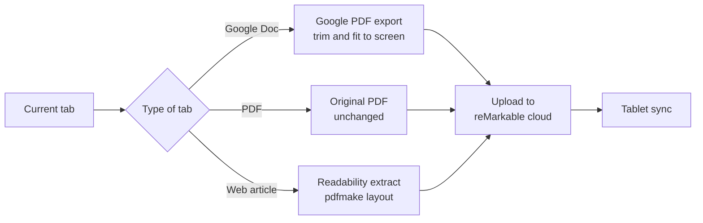

# To reMarkable

A Firefox extension that sends the current tab to a reMarkable tablet as a PDF. The PDF pages match the physical size of the screen of the device that you select.

⚠️ The extension uses the reMarkable cloud API, which reMarkable does not document or support. The official "Read on reMarkable" Chrome extension uses the same requests. reMarkable can change these endpoints at any time, and a change stops uploads until someone updates the extension.

## What it sends

| Tab | What the extension does |
|---|---|
| Google Doc | Downloads Google's PDF export, trims the page margins, and scales each page to the screen. An optional reflow mode lays out the text again for the screen. |
| PDF | Sends the file unchanged. |
| Web article | Extracts the article with [Readability](https://github.com/mozilla/readability), the library that Firefox Reader View uses. Then it lays out the article as a PDF at the size of the screen. |

## Supported devices

| Device | Screen | Page size in the PDF |
|---|---|---|
| reMarkable 2 and reMarkable 1 | 1404 × 1872 px at 226 PPI | 447 × 596 pt |
| reMarkable Paper Pro | 1620 × 2160 px at 229 PPI | 509 × 679 pt |
| reMarkable Paper Pro Move | 954 × 1696 px at 264 PPI | 260 × 463 pt |

The page size is the pixel count divided by the PPI, in points. The Paper Pro figures come from the [reMarkable Paper Pro support page][rmpp]. The Paper Pro Move figures come from the [Paper Pro Move support page][rmppm].

## Install

1. Run `npm install` and then `npm run build`. The build writes `dist/to_remarkable-0.1.0.zip`.
2. In Firefox, open `about:debugging#/runtime/this-firefox`.
3. Select **Load Temporary Add-on** and choose `extension/manifest.json`.

Firefox removes a temporary add-on when it restarts. For a permanent install, sign the zip as an unlisted add-on on [addons.mozilla.org](https://addons.mozilla.org/developers/).

The extension needs Firefox 140 or later.

## Pair your account

1. Open the extension settings. The popup has a **Settings** link.
2. Select **Get a one-time code**. The link opens the [reMarkable connect page][connect].
3. Paste the 8-character code and select **Pair**.

The extension stores the device token in Firefox local storage. **Unpair** deletes the token from Firefox. To revoke access completely, also remove the browser device from your reMarkable account.

## Send a tab

1. Select the toolbar button, or press `Alt+Shift+R`.
2. Select your device.
3. Select **Send**. To look at the PDF first, select **Preview PDF**.

A notification tells you when the upload is complete. The document then syncs to the tablet through your Connect subscription.

## Settings

| Setting | Default | Effect |
|---|---|---|
| Device | reMarkable 2 | Sets the page size and the margins. |
| Google Doc layout | Google's layout | **Google's layout** keeps the export and scales it. **Reflow** lays out the text again for the screen. |
| Trim Google Doc page margins | On | Crops the page margins before the scale step. Headers, footers, and page numbers are in the margins, so the trim removes them too. |
| Article font size | Device default | Sets the body font size in points. The default is 11 pt, or 10 pt for the Paper Pro Move. |

## Limits

- **Paper Pro Move and Google's layout:** A Letter or A4 page is wider than the 9:16 screen. After the scale step, about the bottom quarter of each page stays blank. Use the reflow mode for text-heavy docs.
- **Google Docs reflow:** The reflow mode keeps headings, bold, italic, lists, tables, and images. It does not keep fonts, colors, or exact layout.
- **Article fonts:** The article layout uses Roboto. Roboto has no Chinese, Japanese, or Korean glyphs, so those characters do not appear in the PDF.
- **Local files:** Firefox does not let an extension read `file://` addresses. Open the PDF from a web address instead.
- **Restricted pages:** Firefox blocks extensions on some pages, for example `addons.mozilla.org` and `about:` pages.
- **Google Drive previews:** A PDF preview in Google Drive (`drive.google.com/file/d/...`) is not supported.

## How the upload works

The extension makes three requests. They match the requests in [rmapi-js](https://github.com/erikbrinkman/rmapi-js), which documents the same flow that "Read on reMarkable" uses.

1. **Pair:** `POST https://webapp-prod.cloud.remarkable.engineering/token/json/2/device/new` exchanges the one-time code for a device token that does not expire.
2. **Session:** `POST https://webapp-prod.cloud.remarkable.engineering/token/json/2/user/new` exchanges the device token for a session token. The extension caches the session token until five minutes before it expires.
3. **Upload:** `POST https://internal.cloud.remarkable.com/doc/v2/files` sends the PDF bytes. The `rm-meta` header holds the file name as base64-encoded JSON.

Firefox's `tabs.saveAsPDF()` opens a save dialog and does not return the PDF bytes. For this reason, the extension builds article PDFs itself with [pdfmake](https://github.com/bpampuch/pdfmake). It fits Google Docs pages with [pdf-lib](https://github.com/Hopding/pdf-lib).

## Development

| Command | Effect |
|---|---|
| `npm test` | Runs the unit tests with the Node test runner. |
| `npm run vendor` | Copies the libraries from `node_modules` into `extension/vendor`. |
| `npm run lint` | Runs `web-ext lint`. |
| `npm start` | Starts Firefox with the extension loaded. |
| `npm run build` | Builds the zip in `dist/`. |

`npm run vendor` creates the `extension/vendor` directory, so Git ignores it. The build and lint scripts run `npm run vendor` first.

The code in `extension/lib` has no browser API calls, so the Node tests import it directly. `extension/background/background.js` connects the libraries to the Firefox APIs.

[rmpp]: https://support.remarkable.com/s/article/About-reMarkable-Paper-Pro
[rmppm]: https://support.remarkable.com/s/article/About-reMarkable-Paper-Pro-Move
[connect]: https://my.remarkable.com/device/browser/connect
